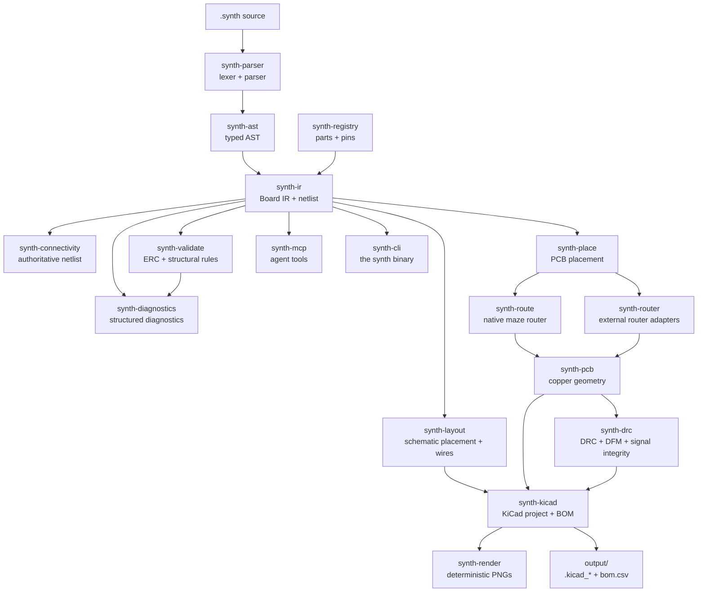

# Compiler Architecture

<Callout type="info">

This section is for **contributors** to the Synth open-source project. If you are looking to build designs, start with [Core Concepts](/user-guide/concepts) or [Quick Start](/user-guide/quick-start).

</Callout>

Synth is a Rust workspace of small crates with explicit boundaries. Each stage consumes the previous stage's typed output and produces a value the next stage can inspect. The compiler is deterministic: the same input and registry produce the same output, including file bytes where the format allows it.



## Compilation Stages

### 1. Lexing and parsing — `synth-parser`

A hand-rolled lexer produces tokens with byte-accurate spans, including comments, string escapes, and engineering units such as `20mm` and `90ohm`. A recursive-descent parser consumes those tokens and continues past syntax errors so one run can report several problems.

- **Input:** UTF-8 `.synth` source.
- **Output:** `synth_ast::DesignFile` plus `synth_diagnostics::Diagnostic`s.
- **Public API:** `lex`, `parse`/`parse_tokens`, `Token`, `TokenKind`, `ParseResult`, and `json::parse_json`.

### 2. AST — `synth-ast`

The typed tree that mirrors the source syntax. Every node carries a `Span`, so any downstream diagnostic can point back to exact bytes. Enum nodes are `#[non_exhaustive]`; adding a statement is a breaking change for exhaustive matches, which is deliberate.

Key nodes: `BoardNode`, `ComponentNode`, `ConnectNode`, `DiffPairNode`, `KeepoutNode`, `PlacementHintNode`, `NetNode`, `ModuleNode`, `InterfaceNode`, `BusNode`.

The AST is not edited by semantic passes. Everything after parsing works on the IR.

### 3. Part resolution — `synth-registry`

Resolves each component's `(kind, part_id)` to a concrete `Part`: pins, electrical types, capabilities, footprint, required support circuits, and provenance.

Resolution order:

1. `--registry <DIR>`
2. `$SYNTH_REGISTRY`
3. `./registry/parts` (walking up ancestors)
4. the embedded seed registry

A Tier-2 overlay (`--user-registry` / `$SYNTH_USER_REGISTRY_DIR`) shadows shipped parts. `--strict-registry` turns a shadowing warning into an error.

### 4. IR lowering — `synth-ir`

Lowers the AST plus resolved parts into the canonical `Board` IR: indexed components, pins, nets, power domains, clusters, diff pairs, and board parameters. All downstream crates — ERC, placement, routing, DRC, KiCad export, MCP — consume `Board` and the indexed IDs (`ComponentId`, `PinId`, `NetId`), not the AST.

The IR maintains the invariants that make the rest of the pipeline simple: every endpoint resolves to a component pin, a net is a stable identity, and lowering is deterministic.

### 5. Diagnostics — `synth-diagnostics`

The shared diagnostic contract. A `Diagnostic` carries a code, severity, title, expected/found text, a `Span`, and an optional `Patch`. The wire format is versioned and has a JSON Schema (`diagnostic_schema()`), so `synth_validate`, the CLI, the MCP server, and the enterprise UI all agree on the shape.

`NativeCheckEvidence` records the result of a native check as pass, fail, or unknown; unknown is never promoted to a pass.

### 6. Connectivity — `synth-connectivity`

The single source of truth for electrical connectivity. `build_connectivity(&Board)` derives `Connectivity`: nets, terminals, and net classes. ERC, placement, routing, DRC, and netlist export all read this derivation instead of each re-deriving the netlist.

### 7. Electrical rules — `synth-validate`

Runs every registered `ErcRule` against the `Board`. The rules cover connectivity, decoupling, I²C/SPI, crystal load capacitors, USB/CC termination, ESD, power domains, regulator loading, thermal estimates, supply-chain identity, schematic readability, and footprint pin cross-checks.

- **Input:** `synth_ir::Board`.
- **Output:** `Vec<synth_diagnostics::Diagnostic>`.
- **Public API:** `run_erc`, `run_erc_with_config`, `ErcRule`, `ErcConfig`, `PinConflictTable`.

Severity is set per diagnostic, not by the `E`/`W` prefix alone.

### 8. Schematic layout — `synth-layout`

Computes deterministic symbol positions and wire routes for the KiCad schematic. One layouter is shared by the KiCad exporter, the MCP tools, and the browser preview, so the views agree.

The output is a `Layout`: `ComponentPlacement`, `WirePath`, `PowerFlag`, `NetLabel`, `GroupBox`, and sheet metadata. The optional `<design>.schematic.layout.toml` sidecar holds **sheet millimetres** and is applied before rendering.

### 9. PCB placement — `synth-place`

Solves physical positions and rotations with integer-nanometer arithmetic. The placement is deterministic: the same board and hints produce the same coordinates. `placement_hint` directives (`near`, `region`, `side`, `edge`, `hard`) are constraints, not suggestions.

Key modules: `floorplan`, `outline_packer`, `fitness`, `routability`, `cem`, `compact_gaps`, `advisor`, `board_family`. The result is the placement the router and DRC consume.

### 10. Copper routing — `synth-route` and `synth-router`

There are two routing paths, and they are deliberately separate:

- **`synth-route`** is the native deterministic maze/A\* router. It produces `synth_pcb` copper directly and is used for power rails and local routing.
- **`synth-router`** is the external-router adapter. It selects an engine (KiCadRoutingTools or FreeRouting), runs it inside hard resource limits, reads the returned board back into `synth_pcb` geometry, and decides independently whether the copper may be called routed.

`synth-router` never trusts the router's own exit code. The terminal state is one of `routed`, `review_required`, `router_unavailable`, or `validation_failed`. A route that cannot be independently validated is not installed as release geometry.

### 11. DRC and DFM — `synth-drc`

Checks the `(Board, Placement, Routing)` triple against a `ManufacturerProfile`: clearance, trace width, drill, annular ring, keepouts, solder mask, silkscreen, and DFM findings. It also includes signal integrity and return-path checks.

- **Public API:** `run_kicad_cli_drc`, `DrcReport`, `DrcCounts`, `NativeDrcOutcome`, `DRC_STAGE`.
- **Signal integrity:** `required_width_nm`, `return_via_window_nm`, `RETURN_VIA_CLEARANCE_NM`.

The same triple and profile produce a byte-identical report.

### 12. KiCad export — `synth-kicad`

Serializes the board into a self-contained KiCad project: `.kicad_pro`, `.kicad_sch`, `.kicad_sym`, `.kicad_pcb`, and `bom.csv`. The exporter is stateless and deterministic. Optional `FabRequest` flags shell out to `kicad-cli` for Gerber, drill, and STEP output; the crate also runs native schematic ERC and the manufacturing/DFM checks.

### 13. Visual feedback — `synth-render`

Deterministic SVG rasterization and pixel diffing. `svg_to_png` turns a rendered sheet into a PNG, `diff_pngs` compares two PNGs, and `visible_text_count` catches a sheet that rendered no text. The pinned stack makes visual baselines reproducible across machines.

### 14. Surfaces — `synth-cli` and `synth-mcp`

`synth-cli` is the `synth` binary: `validate`, `fix`, `export-kicad`, `check`, `layout`, `place`, `route`, `drc`, `render`, `registry`, `part`, `cost`, `supply-chain`, `procurement-lock`, `mcp`, `capability`, and the debugging dumps.

`synth-mcp` exposes the same stages as MCP tools over stdio or HTTP/SSE. It owns the tool catalogue, the server instructions, and an audit log for tool calls.

## Crate Map

| Crate                | Stage     | Responsibility                                                                     |
| :------------------- | :-------- | :--------------------------------------------------------------------------------- |
| `synth-parser`       | Front end | Lexer and recursive-descent parser with span-accurate tokens.                      |
| `synth-ast`          | Front end | Typed AST nodes; every node carries a `Span`.                                      |
| `synth-ir`           | Core      | Canonical `Board` IR, indexed IDs, lowering, power domains, clusters, diff pairs.  |
| `synth-diagnostics`  | Core      | Stable `Diagnostic`, `Patch`, `Span`, and native-check evidence contract.          |
| `synth-registry`     | Core      | Part records, pins, capabilities, two-tier resolution, LCSC import, vector search. |
| `synth-connectivity` | Core      | Authoritative netlist and connectivity derivation.                                 |
| `synth-geometry`     | Core      | Integer-nanometer points, rectangles, layers, stackups, spatial oracles.           |
| `synth-validate`     | Check     | ERC and structural rules; emits diagnostics.                                       |
| `synth-layout`       | Schematic | Deterministic schematic placement and wire routing.                                |
| `synth-place`        | PCB       | Deterministic PCB placement and floorplanning.                                     |
| `synth-pcb`          | PCB       | Copper geometry IR shared by routing, DRC, and export.                             |
| `synth-route`        | PCB       | Native deterministic maze/A\* router.                                              |
| `synth-router`       | PCB       | External router adapters, capability discovery, independent validation.            |
| `synth-drc`          | Check     | DRC, DFM, signal integrity, native KiCad DRC.                                      |
| `synth-kicad`        | Export    | KiCad project, schematic, PCB, BOM, fab, schematic ERC.                            |
| `synth-render`       | Visual    | Deterministic SVG rasterization and pixel diffing.                                 |
| `synth-smt`          | Analysis  | Embedded single-variable SMT-LIB2 solver for quantitative rules.                   |
| `synth-knowledge`    | Analysis  | Declarative support-circuit templates and the circuit-design knowledge graph.      |
| `synth-supply`       | Supply    | LCSC and Nexar stock, pricing, lifecycle, and caching.                             |
| `synth-cost`         | Supply    | Pure, reproducible manufacturing cost reports.                                     |
| `synth-mcp`          | Surface   | MCP server over stdio and HTTP/SSE.                                                |
| `synth-cli`          | Surface   | The `synth` command-line binary.                                                   |

## Contributing

Repository: [github.com/absmach/synth](https://github.com/absmach/synth)

```bash
# Build and test the full workspace
make verify

# Run individual checks
cargo fmt --check
cargo clippy --workspace --all-targets -- -D warnings
cargo test --workspace
```

Run `make help` to see all development commands. The workspace pins Rust in `rust-toolchain.toml`; use the pinned toolchain so generated artifacts stay reproducible.
