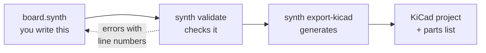
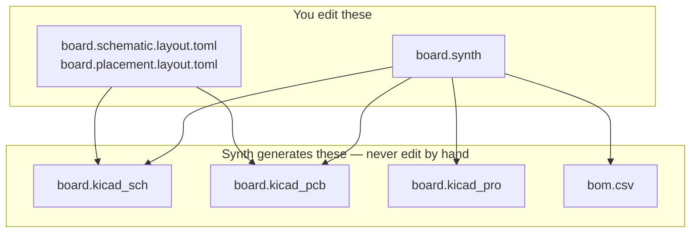

Read this page once before you install anything. It is five minutes, and it explains the handful of ideas that the rest of the documentation assumes you already have.

## The One-Sentence Version

You write a text file describing your circuit; Synth checks it and generates a KiCad project you can open, inspect, and send to a manufacturer.



## Why Describe a Board as Text?

Most PCB tools are graphical: you drag symbols onto a canvas and draw wires between them with a mouse. That works, but the design only exists as a binary file, so you cannot diff it, review it in a pull request, or check it in CI.

Synth takes the other approach. Because your design is a text file:

- **`git diff` shows what changed** — "added a 4.7k pull-up to SCL" is one readable line, not an opaque binary blob.
- **Review happens in pull requests**, the same place your firmware is reviewed.
- **CI can block a bad board.** `synth check` is a pass/fail gate you can run on every commit.
- **The same design always produces the same output.** Nothing depends on where you happened to drop a symbol.

The trade-off is that you type coordinates-free descriptions instead of positioning things by hand. Synth decides the physical positions for you, and you nudge the results when you want to.

## Vocabulary

These terms show up on every page. If you come from software rather than hardware, this is the section that matters most.

| Term                              | What it means                                                                                                    |
| :-------------------------------- | :--------------------------------------------------------------------------------------------------------------- |
| **Component**                     | One physical part on the board — a resistor, a chip, a connector.                                                |
| **Reference designator** (refdes) | The component's unique label on the board: `R1`, `C4`, `U2`. Like a variable name.                               |
| **Pin**                           | One electrical terminal on a component. A resistor has `p1` and `p2`; a regulator has `vin`, `vout`, `gnd`.      |
| **Net**                           | A set of pins that are all electrically joined. "Connect these three pins together" means "put them on one net." |
| **Part ID**                       | The registry key naming _which_ part to use: `r_generic_0603`, `ams1117_3v3`.                                    |
| **Registry**                      | Synth's parts library. Each entry records a part's pins, its KiCad symbol and footprint, and its order code.     |
| **Footprint**                     | The pattern of copper pads a part solders onto.                                                                  |
| **Schematic**                     | The circuit diagram — what connects to what, drawn for humans.                                                   |
| **Layout** / **PCB**              | The physical board — where each part sits and how the copper runs between them.                                  |
| **BOM**                           | Bill of materials: the shopping list of parts, with order codes.                                                 |
| **ERC**                           | Electrical rule check. Catches wiring mistakes: an output driving an output, a chip with no ground.              |
| **DRC**                           | Design rule check. Catches manufacturing mistakes: traces too close together, holes too small for the factory.   |
| **Netlist**                       | The complete list of nets. This is the real content of your design; the schematic is one way to draw it.         |

## What You Own and What Synth Generates

This is the single most important rule in Synth, and the one newcomers trip over.



The `.synth` file is the source of truth. Every exported KiCad file is a build artifact, regenerated from scratch on each export.

<Callout type="error">

If you open the generated `.kicad_sch` in KiCad, move things around, and save, your changes are **destroyed** the next time anyone runs `synth export-kicad`. The export is byte-deterministic: it does not merge, it overwrites.

To change connectivity or values, edit the `.synth` file. To change where things _sit_, use the layout sidecar files, which are preserved. See [KiCad Export](/user-guide/kicad-export).

</Callout>

Think of it the way you think about compiled code: you edit the source, not the binary.

## The Pipeline

When you run a Synth command, your design passes through these stages in order. Knowing their names makes error messages far easier to read, because each diagnostic tells you which stage rejected your design.

| Stage        | What happens                                                                  | What it can reject                                                                     |
| :----------- | :---------------------------------------------------------------------------- | :------------------------------------------------------------------------------------- |
| **Parse**    | Read the text into a syntax tree.                                             | Typos, missing braces (`E-SYNTH-PARSE-*`)                                              |
| **Resolve**  | Look up every part ID in the registry and check that the pins you used exist. | Unknown part, misspelled pin (`E-SYNTH-COMP-*`)                                        |
| **Validate** | Run electrical and readability rules over the netlist.                        | Missing decoupling, floating pins, unnamed nets (`E-SYNTH-POWER-*`, `E-SYNTH-SCHEM-*`) |
| **Place**    | Decide where each component physically sits.                                  | Impossible placement constraints (`E-SYNTH-PLACE-*`)                                   |
| **Route**    | Draw the copper connecting the pads.                                          | Nets that cannot be routed (`E-SYNTH-ROUTE-*`)                                         |
| **Export**   | Write the KiCad project and BOM.                                              | Unresolved footprints (`E-SYNTH-KICAD-*`)                                              |

You do not invoke these individually in normal use. `synth validate` runs parse through validate; `synth export-kicad` runs all of them.

## Errors vs. Warnings

Synth reports problems as **diagnostics**, each with a stable code like `E-SYNTH-VALUE-001`. The first letter tells you how much it matters:

| Prefix | Severity | Effect                                                                   |
| :----- | :------- | :----------------------------------------------------------------------- |
| `E-`   | Error    | Blocks the command. Exit code `1`. You must fix it.                      |
| `W-`   | Warning  | Does not block. Synth is telling you something true about your hardware. |

<Callout type="info">

A warning is not noise. `W-SYNTH-THERMAL-001` saying a regulator will reach 133 °C is a real prediction about a real board. Read your warnings, then decide — do not reflexively silence them.

</Callout>

Every code has a reference page in the repository at `docs/diagnostics/<CODE>.md` explaining the rule and how to satisfy it.

## The Normal Working Loop

Day to day, you will do this:

```bash
# 1. Edit your design in any text editor
$EDITOR board.synth

# 2. Check it — fast, runs offline, no KiCad needed
synth validate board.synth

# 3. Let Synth repair what it can repair automatically
synth fix board.synth

# 4. Once clean, generate the KiCad project
synth export-kicad board.synth --out output/board
```

Steps 1–3 are a tight loop you will run many times. Step 4 you run when you want to look at the result.

## Where Agents Fit

Synth exposes the whole pipeline over the [Model Context Protocol](/user-guide/mcp-server), so an AI assistant can search for parts, draft a design, read the diagnostics, and fix its own mistakes. This is optional — everything works from the command line alone — but it is why diagnostics are structured JSON with machine-readable suggested fixes rather than just prose.

## Next

| If you want to…                             | Go to                                            |
| :------------------------------------------ | :----------------------------------------------- |
| Get Synth onto your machine                 | [Installation](/user-guide/installation)         |
| See it work on a design that already exists | [Quick Start](/user-guide/quick-start)           |
| Write a board yourself, from an empty file  | [Your First Board](/user-guide/first-board)      |
| Look up a piece of syntax                   | [SynthSpec Reference](/user-guide/dsl-reference) |
