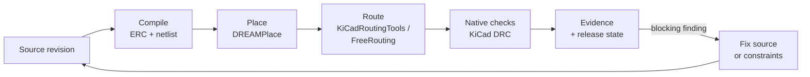

# Builds, Checks, and Recovery

A build is more than “press a button and wait.” Synth EE runs the compiler, places the parts, routes the copper, checks the result, and records the evidence. This page explains what happens at each stage and what to do when a stage goes wrong.

## The Build Pipeline

Each stage is recorded against the revision. If the source changes after a check, the evidence is marked **stale** rather than silently reused.

## Build States

| State            | Meaning                                                         | What you can do                                                |
| :--------------- | :-------------------------------------------------------------- | :------------------------------------------------------------- |
| **Queued**       | The job is waiting for a worker.                                | Wait, or check **Generation activity** if it stays queued.     |
| **Placing**      | Compiling, checking ERC, and finding legal component positions. | Watch the canvas; airwires appear as placement settles.        |
| **Routing**      | The external router is drawing copper.                          | Wait; the router is bounded by a timeout and a fallback.       |
| **Checking DRC** | The delivered board is being checked by native KiCad.           | Wait; this is the evidence stage.                              |
| **Completed**    | The build finished.                                             | Review the checks. Completed is not the same as release-ready. |
| **Failed**       | A stage returned an error or a blocking finding.                | Open **Checks** and read the finding.                          |
| **Blocked**      | The release policy stopped the board.                           | Read the release card and the approval requirement.            |
| **Cancelled**    | A person stopped the build.                                     | Rebuild when ready.                                            |

<Callout type="warn" title="Completed does not mean manufacturable">

A build can complete with findings. **Release** is the separate verdict that combines the current revision, the check evidence, and the release policy. Always read the release card before exporting.

</Callout>

## Status Words in the Interface

The workspace uses a small, consistent vocabulary. The colour tells you how to act.

| Tone                          | Means                                                        | Examples                                                                     |
| :---------------------------- | :----------------------------------------------------------- | :--------------------------------------------------------------------------- |
| **Ready** (green)             | Done and trustworthy.                                        | Completed, Clean, Attested, Frozen, Approved, Quote                          |
| **Running** (blue)            | In progress.                                                 | Queued, Placing, Routing, Checking DRC, Repairing                            |
| **Unresolved** (amber)        | Needs input or evidence.                                     | Estimate, Not attested, Quote required, Incomplete, Stale, Awaiting approval |
| **Blocked** (red)             | Stopped by the design or a policy.                           | Blocked, Over budget, Expired, Quote mismatch                                |
| **Failed** (red)              | An operation failed.                                         | Failed, Lookup failed                                                        |
| **Unavailable** (dashed grey) | A service is down or not configured. Not the design's fault. | Service unavailable, Not configured                                          |
| **Neutral** (grey)            | Nothing to report.                                           | Draft, Cancelled, Not run                                                    |

Two distinctions matter most:

- **Estimate vs. quote.** An estimate is unresolved until a supplier quote backs it.
- **Blocked vs. unavailable.** Blocked is about the board or a policy. Unavailable is about infrastructure. They never share a colour.

## Background Builds and Workers

Builds run in the background. The browser subscribes to progress updates; closing the tab does not stop the job.

- **The SaaS owns the job state.** It persists placement checkpoints, route progress, and evidence.
- **Build workers execute the compiler and durable agent runs.** A worker can be scaled independently of the web tier.
- **The KiCad renderer runs native checks and renders.** If it is unavailable, physical checks cannot be attested.
- **Temporal carries durable agent workflows.** If Temporal is down, manual builds can still work; long agent runs cannot.

If a build stays **Queued**, the worker pool is the first thing to check. If **Physical DRC** stays **Not attested**, check the renderer and the validation endpoint. These are infrastructure failures, and the UI reports them as **Unavailable**, not as a design failure.

## Reading a Finding

Every finding has the same shape:

| Field             | Meaning                                                                                                         |
| :---------------- | :-------------------------------------------------------------------------------------------------------------- |
| **Code**          | A stable identifier such as `E-SYNTH-PLACE-002` or `W-SYNTH-THERMAL-001`. Search the docs or the source for it. |
| **Severity**      | **Error** or **fatal** blocks release. **Warning** is advice.                                                   |
| **Title**         | A short description.                                                                                            |
| **Expected**      | What the rule wanted.                                                                                           |
| **Found**         | What the design actually has.                                                                                   |
| **Location**      | The source range or the physical object.                                                                        |
| **Suggested fix** | A concrete change, when the compiler can offer one.                                                             |

Errors are not necessarily bugs in Synth. A placement error usually means the outline is too small for the parts. A routing error means the router could not produce copper the independent check accepts. Read the expected/found pair before changing the source.

## Evidence and Staleness

The Checks page is an evidence page, not a dashboard. Each card records the revision it checked.

- **Evidence matches the displayed revision** — the card is trustworthy for what is on screen.
- **Checks are stale relative to the current source** — the source or placement changed after the check. Rebuild or re-run before you trust it.
- **Not attested** — there is no trustworthy physical evidence. Export is blocked.
- **Report hash** — the DRC and manufacturing reports carry hashes so you can prove which board produced them.

<Callout type="info" title="Unknown is never promoted to pass">

A timeout, a missing renderer, or an unavailable validator produces **unknown** or **not attested**, never a pass. This is deliberate: a release decision must fail closed.

</Callout>

## Recovery Playbook

### The build stays Queued

1. Open **Generation activity** and check the log.
2. Ask your administrator to confirm the worker is healthy and connected to Temporal.
3. If the worker is healthy, cancel and rebuild.

### Placement fails

The compiler could not find a legal position for a part. This usually means the outline is too small or a `placement_hint` is impossible.

1. Open **Placement & routing**.
2. Increase **Width** and **Height**, or remove an explicit size and let the placer derive one.
3. Select **Apply size & rebuild**.

If the placement error names a specific part, also check that part's footprint and courtyard in **Parts & BOM**.

### Routing fails

The router returned geometry that the independent check rejected, or it timed out.

1. Open **Checks** and read the routing finding.
2. Try the other router, or reduce the pass count.
3. Re-run **Run router & DRC**.
4. If both routers fail, simplify the placement or the net classes in the source.

A failed route does not always destroy the previous geometry. Synth retains the prior board for repair, and the log says whether it did.

### Physical DRC is Not attested

The native check did not run. This is an infrastructure or configuration problem.

1. Ask your administrator to check the KiCad renderer and the validation endpoint.
2. Do not treat the board as passed. The release gate will not either.

### Checks are stale

The source or placement changed after the last check. Rebuild, or re-run the check from **Checks**.

### Export is disabled

Open **Checks** and read the **Release** card. The usual causes are:

- A blocking finding.
- Stale checks.
- An unattested physical stage.
- A release policy that requires an approval.

Resolve the cause, then export again.

## Build Logs

Every build keeps a structured log. **Generation activity** shows the last lines; the full log is available from the same panel. The log records the stage, the router, the pass count, and the reason for any fallback.

When you report a problem, include:

1. The board name and revision.
2. The status and the finding code.
3. The correlation reference shown in the failure message.
4. The last lines of the build log.

That is enough for an administrator to find the same request in the server logs.

## What to Read Next

- [Qualification and Evidence](/user-guide/enterprise/qualification) — what the release record contains.
- [Teams and Access](/user-guide/enterprise/tenant-management) — who can build, approve, and export.
- [Admin and Billing](/user-guide/enterprise/admin-and-billing) — the operator console and deployment health.
