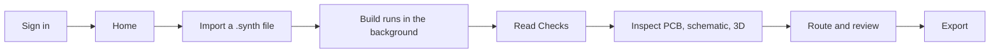

# Sign In and Build Your First Board

This is the page to follow if you have never opened Synth EE before. It takes about fifteen to twenty minutes and ends with a real board you can inspect and export.

We will use the **I2C sensor node** from the open-source qualification corpus: an STM32G030 with a BME680 environmental sensor, an EEPROM, a 5 V input, and an SWD header. It is a complete, reviewed, two-layer board — not a toy example. You can find its source and its review record in the [Synth qualification corpus](https://github.com/absmach/synth/tree/main/qualification/class-a/i2c-sensor-node).

<Callout type="info" title="Already signed in?">

You can skip Step 1. The rest of the page assumes you are looking at your workspace home screen.

</Callout>

---

## What You Will Do

---

## Step 1: Sign In

Open the Synth URL your administrator gave you. You will land on the sign-in page.

Enter your **email or identifier** and **password**, then select **Sign in**.

- If your organization uses single sign-on, the sign-in page will redirect you to your identity provider. There is no separate Synth password in that case.
- If you have an invitation email, open the invitation link instead of the sign-in page. It will take you through account creation.
- If you need a new account and have a beta invite code, choose **Create an account** and enter the code when asked.

<Callout type="warn" title="“Invalid credentials”">

Check the address you used in the invitation. Synth accounts are scoped to the workspace you were invited to. If the invitation has expired, ask a workspace administrator to resend it — do not create a second account with a different address.

</Callout>

After a successful sign-in you land on the workspace home screen.

---

## Step 2: Meet the Home Screen

The home screen has three jobs:

1. **Start a board.** The large text box accepts a plain-language description. **Build my board** starts an AI-assisted design run.
2. **Import an existing design.** **Import .synth** opens a file picker and accepts a `.synth` source file.
3. **Open work you already have.** The **Pick up where you left off** section lists your boards. The **Reference design** card opens the routed RP2350 edge logger if you want to look around before building anything.

The left sidebar is the workspace: **Home**, **Projects**, your recent boards, **Invitations**, **Members**, **Settings**, and **Usage & billing**.

<Callout type="tip" title="The reference design is read-only">

The RP2350 USB-C edge logger is a packaged demo. Open it to see a fully populated workspace without waiting for a build. Your own boards appear under **Projects** after you create them.

</Callout>

---

## Step 3: Import the Qualification Board

For this walkthrough we will import a source file rather than describe a board. This keeps the first run deterministic and gives you a real board to review.

1. On the open-source Synth checkout, open `qualification/class-a/i2c-sensor-node/i2c_sensor_node.synth`.
2. On the home screen, select **Import .synth**.
3. Choose that file.

Synth reads the `board "i2c_sensor_node"` declaration, creates a project, saves the first revision, and immediately starts a build. You do not need to press anything else.

<Callout type="info" title="What gets imported">

The import takes the single `.synth` source file. Synth places the board from the source's component hints. The qualification corpus also ships a placement sidecar (`.placement.layout.toml`); it is optional, but a sidecar is the authoritative placement when one exists. To attach it, open **Export → Layout files → PCB placement layout** and upload it, then rebuild. A sidecar that declares schematic-only keys (`forced_net_labels`, `fit_sheet`) is rejected in the placement slot — remove those lines or use the sidecar the core wrote for the board.

</Callout>

You are taken straight to the new board's workspace. The header shows the board name, the revision badge, and a status pill.

---

## Step 4: Watch the Build

A build has four visible phases:

| Phase            | What Synth is doing                                                | What you see                           |
| :--------------- | :----------------------------------------------------------------- | :------------------------------------- |
| **Queued**       | Waiting for a build worker.                                        | A queued badge and 0%.                 |
| **Placing**      | Compiling the source, checking ERC, and placing the parts.         | The airwires appear on the PCB canvas. |
| **Routing**      | Running the external router, then checking the delivered copper.   | Track segments and vias appear.        |
| **Checking DRC** | Running the native KiCad design-rule check and recording evidence. | The status moves toward **Completed**. |

You can close the tab. The build runs on the server and the result is waiting when you return.

Open **Generation activity** at the bottom of the workspace (or in the left tool rail) to see the run log, the current step, and a **Stop** button. The log is the same information the server records, so it is the first place to look if a build does not finish.

<Callout type="tip" title="Status words mean specific things">

**Completed** means the build finished. It does not mean the design is ready to manufacture. Release readiness is a separate verdict that also requires the checks to be current and any blocking findings to be resolved. See [Builds, Checks, and Recovery](/user-guide/enterprise/agent-worker).

</Callout>

---

## Step 5: Look at the Board

When the build completes, the PCB view is selected by default.

The workspace has four regions:

- **Top bar** — board name, revision, status, **Command** (⌘K), **New board**, and **Export**.
- **View tabs** — **PCB**, **Schematic**, and **3D**. The **Details** menu opens the rest of the tools.
- **Design rail** (left edge) — **Board**, **Synth source**, **Parts & BOM**, **Connections**, **Architecture**, **Checks**, **Versions**, **Placement & routing**, **Sourcing**, **Cost**, **Delivery**, and **Project settings**.
- **Design chat** (right) — ask a question about the board, request a change, or start a durable agent run when a model provider is configured.

The footer summarises the physical board: size in millimetres, layer count, part count, and the current DRC state. The small **Airwires** toggle shows the connections that are not yet routed.

<Callout type="info" title="A build can finish without accepted copper">

If the status is **Completed** but the footer says **DRC not attested** and the canvas has no copper, the router returned geometry that the independent check did not accept. The parts and airwires are still there; the **Checks** page explains what stopped the route. This is a review state, not a silent success.

</Callout>

Try these three things before moving on:

1. Select a component on the canvas. The inspector opens with its reference, value, footprint, and nets.
2. Toggle **Front**, **Back**, and **Silk** to see the copper and silkscreen layers.
3. Switch to **Schematic** and **3D** to confirm the generated views match the board.

---

## Step 6: Read the Source and Validate It

Open **Synth source** in the design rail.

This is the exact source the build used. The badge at the top tells you whether you are looking at a saved revision or a draft.

- **Check source** runs the compiler and fills the **Problems** list. It is fast and does not change the board.
- **Save draft** saves the source as a new revision without building.
- **Build board** saves the source and starts a new physical build.

The **Problems** panel shows the diagnostic code, severity, and a plain-language explanation. A warning is advice; an error blocks export until it is fixed.

<Callout type="tip" title="Edit in the source, never in KiCad">

If you need to change a value, a connection, or a placement hint, change it here and rebuild. The KiCad files are generated on every build. Editing them directly is not preserved.

</Callout>

For this imported board, choose **Check source**. The expected result is a clean compile with warnings only — for example, a thermal estimate for the regulator. Warnings do not block the release; errors do.

---

## Step 7: Review the Checks

Open **Checks** in the design rail.

The page is organised as four cards:

| Card             | What it answers                                                             |
| :--------------- | :-------------------------------------------------------------------------- |
| **Compiler ERC** | Does the source describe a valid circuit? Are there electrical-rule errors? |
| **Physical DRC** | Does the delivered copper pass the fabrication rules?                       |
| **Routing**      | Are all nets connected, and did the router leave valid geometry?            |
| **Release**      | Is this revision ready to export?                                           |

The filters above the findings list let you show **All**, **Blocking**, or **Warnings**. Each finding carries a code such as `E-SYNTH-PLACE-002`, the expected condition, what was found, and a link to the explanation.

The line **Evidence matches the displayed revision** is important. If it says the checks are stale, the source or placement changed after the last check. Rebuild or re-run the check before you trust the result.

<Callout type="warn" title="“Not attested” is not a pass">

**Not attested** means Synth does not have trustworthy physical evidence for that stage. It is not a clean result. Export is blocked until the stage is attested or the release policy explicitly allows it. The reason is shown next to the card — for example, a missing renderer or an unavailable build worker.

</Callout>

On a clean build, the sequence is:

1. **Compiler ERC** passes or reports warnings only.
2. **Physical DRC** moves from **Not attested** to **Attested** after the KiCad check.
3. **Routing** reports the connected nets and any non-blocking return-via advisories.
4. **Release** becomes **Ready** when the revision, checks, and evidence all agree.

If a card is **Failed**, **Blocked**, or still **Not attested**, read the finding before changing anything. A **Completed** build with an unattested check is not release-ready: the Release card stays blocked until the evidence exists. The most common causes are a placement that cannot fit the outline and a router that returned geometry the independent check rejected.

---

## Step 8: Route and Review the Copper

Open **Placement & routing** in the design rail.

This page has two independent controls:

- **Physical outline** — width and height in millimetres, with **Apply size & rebuild**. Use this when the auto-derived outline is too tight or when the board must fit an enclosure.
- **Placement & routing** — router (**KiCadRoutingTools** or **FreeRouting**), **Passes**, **Threads**, and **Run router & DRC**.

The note at the bottom explains the rule that matters: width, height, layer count, and manufacturer are **source declarations**. This panel submits physical constraints to the compiler; it does not silently rewrite the `.synth` file.

<Callout type="tip" title="Let the placer choose the size first">

If you do not have a mechanical constraint, leave the outline alone and rebuild. Synth derives a compact outline from the footprints and the source's placement hints. Apply an explicit size only when you actually need one.

</Callout>

If the build already routed the board, you do not need to run the router again. Use **Run router & DRC** when you want a fresh attempt, a different router, or a different number of passes.

---

## Step 9: Inspect the Manufacturing Data

Use the rail to open the remaining review tools. Each one is covered in detail in the [Workspace Tour](/user-guide/enterprise/synth-ui); for the first session, check these four:

- **Parts & BOM** — every reference, value, footprint, and supplier identity. Confirm that the parts are the ones you expect.
- **Connections** — every net and its pins. **No open nets reported** is the sentence you want.
- **Architecture** — the board's functional groups, power rails, and signal nets. This is the fastest way to understand a design someone else wrote.
- **Versions** — every saved revision, with its content hash and creation time. You can restore an earlier revision without losing the current one.

---

## Step 10: Export the Board

Select **Export** in the top bar. The source and the artifacts that exist are always downloadable; the **Manufacturing package** row stays disabled until the release evidence is current.

The export dialog lists the files that will be written:

| File                   | Use                                         |
| :--------------------- | :------------------------------------------ |
| `.kicad_sch`           | Native KiCad schematic.                     |
| `.kicad_pcb`           | Native KiCad board, with the routed copper. |
| `.kicad_pro`           | KiCad project file.                         |
| `bom.csv`              | Bill of materials.                          |
| `pnp.csv`              | Pick-and-place positions for assembly.      |
| Gerber and drill files | The fabrication package.                    |

The export is a **release artifact**, not a checkpoint. It records the revision, the checks, and the evidence that produced it. Download the `.zip` and open the KiCad project locally if you want to inspect the result in KiCad.

<Callout type="warn" title="Export is blocked when the evidence is not trustworthy">

Synth will not hand you a manufacturing package for a revision with unresolved blocking findings, stale checks, or unattested physical evidence. If **Export** is disabled, open **Checks** and read the blocking finding. That is the product working as intended, not a bug.

</Callout>

---

## What “Done” Looks Like

You have finished the first session when all of these are true:

- The header status is **Completed**.
- **Checks** shows the compiler, physical DRC, and routing evidence for the **current** revision.
- **Release** is **Ready** (or the only remaining item is a policy approval).
- **Connections** reports no open nets.
- **Export** produces a package you can open in KiCad.

That is the loop: **edit the source → build → read the checks → fix → export**. Everything else in Synth EE supports one of those steps.

---

## If Something Goes Wrong

| Symptom                              | First thing to check                                                                                                   |
| :----------------------------------- | :--------------------------------------------------------------------------------------------------------------------- |
| Build stays **Queued**               | The build worker may be down. Ask your administrator to check the worker and the Temporal connection.                  |
| Build fails at **Placing**           | Usually an outline that is too small. Open **Placement & routing**, increase the outline, and rebuild.                 |
| **Routing** fails or is **Blocked**  | Read the routing finding. Try the other router or a lower pass count, then re-run.                                     |
| **Physical DRC** is **Not attested** | The KiCad renderer or the validation endpoint is unavailable. This is an infrastructure problem, not a design problem. |
| **Checks are stale**                 | The source or placement changed after the last check. Rebuild or re-run the check.                                     |
| Export is disabled                   | There is a blocking finding, a stale check, or an unapproved release. Open **Checks**.                                 |

The next page, [Builds, Checks, and Recovery](/user-guide/enterprise/agent-worker), explains every status and the recovery path in more detail.
