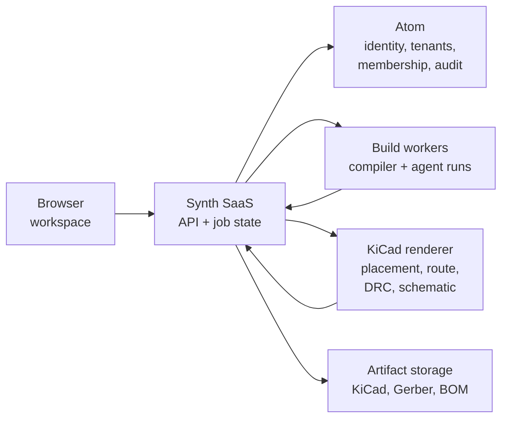

# Synth Enterprise Edition

Synth Enterprise Edition (Synth EE) is the hosted version of Synth. The compiler, the SynthSpec language, and the command-line tool are the same open-source engine you can run locally. Synth EE adds a browser workspace, managed builds, team access, and a review record around that engine.

If you have used the open-source CLI, nothing you know changes. If you have never designed a board before, this page gives you the mental model and points you at the shortest working path.

<Callout type="info" title="You do not need to install anything">

Everything in this guide runs in a browser. The open-source CLI is still the right tool for CI, scripting, and offline work — see the [Community documentation](/user-guide/installation) — but you do not need it to complete the enterprise walkthrough.

</Callout>

---

## The Twenty-Minute Path

Follow these pages in order. Each one ends with something you can see on screen.

| #   | Page                                                                         | What you get                                                                                |
| :-- | :--------------------------------------------------------------------------- | :------------------------------------------------------------------------------------------ |
| 1   | [Sign In and Build Your First Board](/user-guide/enterprise/getting-started) | A real qualification board, imported, built, checked, routed, and exported. _15–20 min_     |
| 2   | [Workspace Tour](/user-guide/enterprise/synth-ui)                            | What every panel does, and when to use it. _8 min_                                          |
| 3   | [Builds, Checks, and Recovery](/user-guide/enterprise/agent-worker)          | How to read a status, what a finding means, and how to recover from a failed build. _6 min_ |
| 4   | [Teams and Access](/user-guide/enterprise/tenant-management)                 | Invite people, assign roles, and read the audit trail. _5 min_                              |
| 5   | [Qualification and Evidence](/user-guide/enterprise/qualification)           | The evidence a release carries and how to reproduce it. _6 min_                             |

Administrators should also read [Admin and Billing](/user-guide/enterprise/admin-and-billing).

---

## What Synth EE Adds

| Capability                                                    | Community (open source) | Enterprise (Synth EE) |
| :------------------------------------------------------------ | :---------------------: | :-------------------: |
| SynthSpec compiler, validation, ERC                           |           ✅            |          ✅           |
| KiCad, Gerber, drill, BOM export                              |           ✅            |          ✅           |
| Component registry and part import                            |           ✅            |          ✅           |
| `synth` CLI and MCP server                                    |           ✅            |          ✅           |
| Browser workspace with PCB, schematic, and 3D views           |           ❌            |          ✅           |
| Managed build queue and background workers                    |           ❌            |          ✅           |
| Multi-model design chat (when a model provider is configured) |           ❌            |          ✅           |
| Teams, invitations, roles, and audit trail                    |           ❌            |          ✅           |
| Release evidence and qualification records                    |           ❌            |          ✅           |

---

## How the Pieces Fit

You work in a browser. The browser never holds a role, a compiler binary, or a manufacturing credential. Every action is checked on the server.

| Piece                | What it does                                                                                              | You touch it?        |
| :------------------- | :-------------------------------------------------------------------------------------------------------- | :------------------- |
| **Workspace**        | The browser app at `/app` — boards, tools, chat, review.                                                  | Yes, daily.          |
| **Synth SaaS**       | Owns projects, revisions, builds, checks, and release state.                                              | No.                  |
| **Atom**             | The identity and tenancy service. Owns accounts, workspaces, invitations, permissions, and the audit log. | Only through the UI. |
| **Build workers**    | Run the compiler and any durable agent workflow. A closed browser tab does not stop a build.              | No.                  |
| **KiCad renderer**   | Runs the native KiCad checks and renders the schematic, PCB, and 3D views.                                | No.                  |
| **Artifact storage** | Holds exported KiCad, Gerber, drill, BOM, and evidence files.                                             | Through **Export**.  |

<Callout type="warn" title="The source is the design">

A `.synth` file is the only editable design input. The KiCad schematic, PCB, BOM, and Gerber files are generated artifacts. Editing them and then rebuilding will silently discard the edit. Make every design change in the source, or through a tool that edits the source for you.

</Callout>

---

## What You Need

To follow the walkthrough you need:

1. **An account.** Your organization may send an invitation, or an administrator may give you a beta invite code.
2. **A modern browser.** Chrome, Edge, Firefox, or Safari from the last two years.
3. **Nothing else.** No KiCad install, no compiler, no local server — unless you are the person deploying Synth EE.

If you are the administrator standing up a new deployment, use the deployment notes in the repository.

---

## Getting Access

Synth EE is commercially licensed. Ask your Synth contact for a workspace invitation, or use the contact link on the Synth website. Once you have an account, continue to [Sign In and Build Your First Board](/user-guide/enterprise/getting-started).
