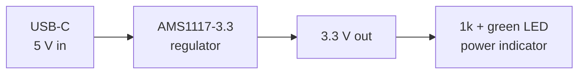

The [Quick Start](/user-guide/quick-start) showed you Synth working on a design that already existed. This page is different: you will write a board yourself, starting from nothing, and deliberately walk into the errors Synth reports so you learn to read them.

The board we are building is small but genuinely useful — a **USB-C powered 3.3 V supply with a power-on LED**:



Every diagnostic quoted on this page is real output, not an illustration. You should see the same codes as you follow along.

<Callout type="info" title="Before you start">

You need Synth installed and a checkout to run from — see [Installation](/user-guide/installation). Every command below assumes `synth` is on your `PATH` and you are inside the repository checkout, because the parts registry lives there.

</Callout>

## Step 1: The Smallest Board That Compiles

Create a file called `power_led.synth` anywhere you like and put three lines in it:

```rust title="power_led.synth"
board "power_led" {
  layers 2
  manufacturer "jlcpcb"
}
```

That is a complete, valid design. It declares a board called `power_led`, two copper layers, and that JLCPCB will build it — which is what tells Synth whose manufacturing limits to check against.

Check it:

```bash
synth validate power_led.synth
```

```text
warning: board has no components [E-SYNTH-BOARD-002]
  expected: at least one component declared on the board
  found:    zero components
```

One warning, zero errors. Synth is pointing out the obvious, and the command still succeeds — that is the difference between a warning and an error. Let us give it something to complain about properly.

## Step 2: Add Components (and Read the Errors)

Add three parts — the USB-C connector, a resistor, and an LED:

```rust title="power_led.synth"
board "power_led" {
  layers 2
  manufacturer "jlcpcb"

  component J1: connector "usb_c_receptacle"
  component R3: resistor "r_generic_0603"
  component D1: led "led_green_0603"
}
```

Each line reads: **`component`**, then the reference designator (`J1`), then the kind (`connector`), then the registry part ID in quotes.

```bash
synth validate power_led.synth
```

Now you get three errors. This is the interesting part, because every one of them is a real hardware mistake — not a syntax complaint:

```text
error: generic passive with no value [E-SYNTH-VALUE-001]
  found:   no `value` on generic resistor (part `r_generic_0603`)
  message: add `value "10k"` to `R3`

error: USB-C CC pin left floating [E-SYNTH-USB-002]
  found:   `J1.cc1` and `J1.cc2` connected to nothing; a compliant source
           never detects the sink and never turns VBUS on

error: missing support circuit `led_current_limit` [E-SYNTH-KG-001]
  found:   LED has no series current-limiting resistor on either terminal
```

Take them one at a time, because each teaches you something:

**`E-SYNTH-VALUE-001` — the resistor has no value.** `r_generic_0603` says "a resistor in an 0603 package," but not how many ohms. A board house cannot buy "a resistor." Generic passives must declare a `value`, and a missing one is an error rather than a warning precisely because it would otherwise reach the BOM unnoticed.

**`E-SYNTH-USB-002` — the USB-C CC pins are floating.** This one catches out nearly every first-time USB-C design. A USB-C power supply will not switch on its 5 V output until it detects a device asking for power, and a device signals that by pulling each of its two `CC` pins to ground through a 5.1 kΩ resistor. Leave them unconnected and you get a board that is simply dead. Synth knows this rule and will not let you ship it by accident.

**`E-SYNTH-KG-001` — the LED has no current limit.** An LED is not a resistor; once it conducts, it will draw as much current as the rail can deliver and destroy itself. It needs a resistor in series.

## Step 3: Fix All Three

Three fixes: give `R3` a value, add the two CC pull-down resistors, and wire the LED through `R3` instead of leaving it adrift.

```rust title="power_led.synth"
board "power_led" {
  layers 2
  manufacturer "jlcpcb"

  component J1: connector "usb_c_receptacle"
  component R1: resistor "r_generic_0603" value "5.1k"
  component R2: resistor "r_generic_0603" value "5.1k"
  component R3: resistor "r_generic_0603" value "1k"
  component D1: led "led_green_0603"

  connect J1.cc1 -> R1.p1 as "CC1"
  connect J1.gnd -> R1.p2 as "GND"
  connect J1.cc2 -> R2.p1 as "CC2"
  connect J1.gnd -> R2.p2 as "GND"
}
```

Two new pieces of syntax appeared:

- **`value "5.1k"`** — the display value, used on the schematic and in the BOM.
- **`connect A.pin -> B.pin as "NAME"`** — joins two pins onto one electrical net and names that net. The name is optional, but you should almost always supply one: a named net shows up as a readable label on the schematic, whereas an unnamed one is auto-named `net_7` and gets flagged by `E-SYNTH-SCHEM-014`.

Note how `GND` works. Four separate `connect` statements all say `as "GND"`, which puts every one of those pins on the _same_ net. That is how you build a net with more than two pins — repeat `connect` and reuse the name.

<Callout type="info" title="Finding pin names">

How do you know the connector's pins are called `cc1`, `cc2`, and `gnd`? Ask the registry:

```bash
synth registry list          # every available part ID
```

Guessing pin names is the most common way to waste time here. Look them up — [Component Registry](/user-guide/registry-and-fixtures) covers the search tools.

</Callout>

## Step 4: Add the Regulator

USB-C delivers 5 V, but most chips want 3.3 V. An **LDO regulator** converts one to the other. The AMS1117-3.3 takes 5 V on `vin` and produces 3.3 V on `vout`.

Regulators need capacitors on both sides to stay stable — one on the input, one on the output. Add the regulator, its capacitors, and the bulk capacitor on the incoming 5 V:

```rust
  component C1: capacitor "c_generic_0805" value "10uF"
  component U1: regulator "ams1117_3v3" value "AMS1117-3.3"
  component C2: capacitor "c_generic_0805" value "22uF"
  component C3: capacitor "c_generic_0805" value "22uF"
  component C4: capacitor "c_generic_0603" value "100nF"

  connect J1.vbus -> C1.p1 as "VBUS"
  connect J1.gnd  -> C1.p2 as "GND"

  connect J1.vbus -> U1.vin as "VBUS"
  connect J1.gnd  -> U1.gnd as "GND"
  connect U1.vin  -> C2.p1 as "VBUS"
  connect U1.gnd  -> C2.p2 as "GND"
  connect U1.vout -> C3.p1 as "+3V3"
  connect U1.gnd  -> C3.p2 as "GND"
  connect U1.vout -> C4.p1 as "+3V3"
  connect U1.gnd  -> C4.p2 as "GND"

  connect U1.vout    -> R3.p1 as "+3V3"
  connect R3.p2      -> D1.anode as "LED_A"
  connect D1.cathode -> U1.gnd as "GND"
```

The last three lines are the LED circuit, and they show what "in series" means concretely: 3.3 V goes into the resistor, the resistor's other leg goes to the LED's anode, and the LED's cathode returns to ground. Current has no path that skips the resistor.

Why two capacitors on the 3.3 V output (`C3` at 22 µF and `C4` at 100 nF)? Large and small capacitors absorb different speeds of disturbance — the big one handles slow sags, the small one handles fast spikes. Synth checks for this: a rail with only one capacitor raises `E-SYNTH-POWER-001`.

## Step 5: Group It So the Schematic Is Readable

Your design is now electrically complete. But if you exported it right now, the schematic would come out as one undifferentiated row of 9 components — technically correct, unreadable in practice.

`group` fixes that. A group becomes a titled, coloured box on the schematic sheet, and its members get placed together inside it. Wrap each functional block, and add a `notes` block recording the intent that the netlist itself cannot express:

```rust title="power_led.synth"
board "power_led" {
  layers 2
  manufacturer "jlcpcb"

  group "USB-C INPUT" color "#c2410c" {
    component J1: connector "usb_c_receptacle"
    component R1: resistor "r_generic_0603" value "5.1k"
    component R2: resistor "r_generic_0603" value "5.1k"
    component C1: capacitor "c_generic_0805" value "10uF"
    notes "" {
      "VBUS 5 V in. CC1/CC2 pulled down 5.1k each: advertises a 5 V sink."
      "C1 is the bulk cap on VBUS, right at the connector."
    }
  }

  group "3V3 REGULATOR" color "#0072b2" {
    component U1: regulator "ams1117_3v3" value "AMS1117-3.3"
    component C2: capacitor "c_generic_0805" value "22uF"
    component C3: capacitor "c_generic_0805" value "22uF"
    component C4: capacitor "c_generic_0603" value "100nF"
    notes "" {
      "AMS1117-3.3 LDO, always on. 5 V in, 3.3 V out."
      "C2 input, C3 output bulk, C4 high-frequency decoupling."
    }
  }

  group "POWER LED" color "#0a7d4a" {
    component R3: resistor "r_generic_0603" value "1k"
    component D1: led "led_green_0603"
    notes "" {
      "Power-on indicator. 1k from 3.3 V gives about 1.1 mA."
    }
  }

  connect J1.vbus -> C1.p1 as "VBUS"
  connect J1.gnd  -> C1.p2 as "GND"
  connect J1.cc1  -> R1.p1 as "CC1"
  connect J1.gnd  -> R1.p2 as "GND"
  connect J1.cc2  -> R2.p1 as "CC2"
  connect J1.gnd  -> R2.p2 as "GND"

  connect J1.vbus -> U1.vin as "VBUS"
  connect J1.gnd  -> U1.gnd as "GND"
  connect U1.vin  -> C2.p1 as "VBUS"
  connect U1.gnd  -> C2.p2 as "GND"
  connect U1.vout -> C3.p1 as "+3V3"
  connect U1.gnd  -> C3.p2 as "GND"
  connect U1.vout -> C4.p1 as "+3V3"
  connect U1.gnd  -> C4.p2 as "GND"

  connect U1.vout    -> R3.p1 as "+3V3"
  connect R3.p2      -> D1.anode as "LED_A"
  connect D1.cathode -> U1.gnd as "GND"
}
```

Two details worth noting. Components keep **board-unique** reference designators regardless of which group they are in — there is only one `R1` on the whole board. And `connect` statements may cross group boundaries freely; the groups organise the drawing, not the electrical model.

`notes ""` takes a title as its first argument; an empty string means an untitled block.

## Step 6: Validate

```bash
synth validate power_led.synth
```

```text
0 errors, 6 warnings
```

**Zero errors.** The design is electrically sound and ready to export. The six remaining warnings are worth understanding rather than ignoring, because they are the honest residue of a cheap design:

| Warning               | What it is telling you                                                                                                                                                                                                      |
| :-------------------- | :-------------------------------------------------------------------------------------------------------------------------------------------------------------------------------------------------------------------------- |
| `E-SYNTH-ESD-001` ×3  | The USB-C `vbus`, `cc1`, and `cc2` lines run straight into your board with no protection. A static discharge on the connector, or a reversed supply, reaches your parts directly. Real products add a TVS diode array here. |
| `W-SYNTH-THERMAL-001` | The AMS1117 is a _linear_ regulator: it burns the voltage difference off as heat. Synth estimates the junction reaching ~133 °C at full load. Fine for an LED; not fine if you hang a real load off this rail.              |
| `E-SYNTH-SCHEM-001`   | A ground symbol is drawn pointing up instead of down — cosmetic, affects the sheet only.                                                                                                                                    |
| `E-SYNTH-SCHEM-003`   | `C1` ends up placed far from `U1` on the sheet. Tunable via a placement hint.                                                                                                                                               |

<Callout type="info">

Codes beginning `E-` are _usually_ errors, but severity is set per-diagnostic, not by the prefix alone — `E-SYNTH-ESD-001` ships as a warning here. Trust the reported severity and the exit code, not the letter.

</Callout>

This is the real lesson of the page: Synth did not just check your syntax. It checked that your USB-C port would negotiate power, that your LED would survive, that your rail was decoupled, and it then told you how hot your regulator will run.

## Step 7: Export and Look at It

```bash
synth export-kicad power_led.synth --out output/power_led
```

<Callout type="warn" title="The minimal board is a learning board">

The 2-layer, 24-pin USB-C version on this page can stop at the router's escape check: the 0.50 mm pads leave no room for a fabrication-floor via between them. That is why the repository's production file uses a four-layer board and a six-pad power-only USB-C. If your export reports a routing failure here, you have still completed the learning exercise; continue to Step 8 for the layout that routes.

</Callout>

You now have a KiCad project:

```text
output/power_led/
├── power_led.kicad_pro   ← open this one
├── power_led.kicad_sch   ← the schematic
├── power_led.kicad_pcb   ← the board layout
├── power_led.kicad_sym   ← symbols used by the schematic
└── bom.csv               ← the shopping list
```

Open it:

```bash
kicad output/power_led/power_led.kicad_pro
```

You should see your three coloured group boxes, each with its notes printed underneath, and the nets labelled `VBUS`, `+3V3`, `GND` rather than `net_4`.

<Callout type="error">

Do not fix anything you dislike by editing the KiCad files. They are regenerated from scratch on every export and your edits will vanish. Change `power_led.synth`, or use the layout sidecars described in [KiCad Export](/user-guide/kicad-export).

</Callout>

## Step 8: The Production Version

The nine-component board above is deliberately minimal: it teaches the language and the checks without hiding them behind protection circuitry. The `power_led.synth` in the repository root is the **production version** of the same board. It adds the parts a real product needs and changes the connector so the board can actually be routed at JLCPCB's standard process.

| What changes                                            | Why                                                                                                                                                          |
| :------------------------------------------------------ | :----------------------------------------------------------------------------------------------------------------------------------------------------------- |
| `layers 4`                                              | The six-pad USB-C is 1.00 mm pitch; four layers give the route room for the protection cluster and keep the signal returns short.                            |
| `J1` becomes `usb_c_power_6p`                           | A six-pad power-only USB-C (GCT USB4125) carries VBUS, GND, CC1, and CC2 without the 24-pin data pins. The 24-pin part is what made the first route fail.    |
| `F1` polyfuse on VBUS                                   | A fault or a reversed supply opens the fuse instead of the connector.                                                                                        |
| `D_REV` Schottky                                        | Blocks a reversed supply before it reaches the regulator.                                                                                                    |
| `D_TVS` PTVS6V0S1UR                                     | Clamps a transient on the protected 5 V rail.                                                                                                                |
| `D_ESD` SRV05-4                                         | Protects CC1 and CC2, the two external signals that remain.                                                                                                  |
| `C5` 100 nF                                             | Local decoupling at the connector, which `E-SYNTH-KG-001` asks for.                                                                                          |
| `manufacturer "jlc-filled-via"` + `requires via_in_pad` | The 6-pad USB-C still needs two vias in the A9/B9 pads. JLCPCB fills and caps them, and the source declares that process so the route gate accepts the vias. |
| `H1`–`H4`                                               | Four M2.5 mounting holes, one in each corner.                                                                                                                |

The production source also declares its nets explicitly, with classes and a slow edge rate:

```rust
  netclass "PWR" { trace_width 0.4mm clearance 0.2mm via_diameter 0.6mm via_drill 0.3mm edge_rate slow }
  netclass "SIG" { trace_width 0.25mm clearance 0.2mm via_diameter 0.46mm via_drill 0.2mm edge_rate slow }
  netclass "GND" { trace_width 0.4mm clearance 0.2mm via_diameter 0.6mm via_drill 0.3mm edge_rate slow }

  power "VBUS_RAW" 5v class "PWR" { J1.vbus J1.vbus_b F1.p1 C5.p1 }
  power "VBUS_FUSED" 5v class "PWR" { F1.p2 D_REV.anode }
  power "VBUS" 5v class "PWR" { D_REV.cathode D_TVS.cathode C1.p1 U1.vin C2.p1 D_ESD.vcc }
  power "GND" 0v class "GND" { J1.gnd J1.gnd_b J1.shield C5.p2 D_TVS.anode C1.p2 R1.p2 R2.p2 D_ESD.gnd U1.gnd C2.p2 C3.p2 C4.p2 D_LED.cathode }
  power "+3V3" 3.3v class "PWR" { U1.vout C3.p1 C4.p1 R3.p1 }

  net "CC1" class "SIG" { J1.cc1 R1.p1 D_ESD.ch1 }
  net "CC2" class "SIG" { J1.cc2 R2.p1 D_ESD.ch2 }
  net "LED_A" class "SIG" { R3.p2 D_LED.anode }
```

The net blocks do three jobs at once: they name the nets, they assign the net class, and they give the schematic its correct power symbols. The `edge_rate slow` declaration is what tells the router this is a slow power board, so a missing ground-return via is an advisory rather than a hard fast-edge finding for the CC lines.

The deterministic layout is in `power_led.placement.layout.toml` (board millimetres). It puts the USB-C and protection chain on the left, the LDO and its capacitors on the right, and the LED at the far right. The CLI discovers the sidecar by its canonical name, so `export-kicad` uses it automatically:

```bash
synth export-kicad power_led.synth --out output/power_led
```

The production board validates with **0 errors**, and with the filled-via process the included sidecar is a **release-ready** layout: the 4-layer route connects all 8 nets, KiCad reports **0 DRC errors and 0 unconnected pads**, and `release.json` reports `release_ready: true` and `production_status: "production"`.

The trade-off is the process. The route places two vias in the USB-C A9/B9 pads (J1), which the standard process rejects. `manufacturer "jlc-filled-via"` plus `requires via_in_pad` declares the filled-and-capped via process, and the fabrication note on the package says so. Order the board with **filled and capped vias**; JLCPCB offers that process, but it costs more than the standard two-layer service.

```bash
synth export-kicad power_led.synth --out output/power_led
```

If your fabricator cannot fill vias, you have three alternatives:

1. Open the draft in KiCad and add a ground stitching via beside each flagged signal via, then re-export; or
2. Replace the USB-C connector with a coarser-pitch input such as a JST XH header, which removes the fine-pitch escape entirely; or
3. Use `--place-route-iterate` to let Synth try the other placement candidates and keep the one that routes best:

```bash
synth export-kicad power_led.synth \
  --out output/power_led \
  --place-route-iterate
```

The important lesson: **a board can be electrically correct and still not be fabricable.** The router, the DRC, the process declaration, and the release gate are separate checks, and `synth export-kicad` only labels a package release-ready when they all agree.

### The Complete Production File

```rust title="power_led.synth"
// USB-C 5 V in, 3.3 V out, power-on LED.
//
// This is the finished board from the "Your First Board" tutorial. It is a
// four-layer board, and it carries the protection a real product needs: a
// resettable fuse, reverse-polarity blocking, a TVS on VBUS, and a TVS array
// on CC1/CC2. The six-pad USB-C still needs two vias in the A9/B9 pads, so the
// board declares JLCPCB's filled-and-capped via process (`requires via_in_pad`).
board "power_led" {
  layers 4
  manufacturer "jlc-filled-via"

  netclass "PWR" { trace_width 0.4mm clearance 0.2mm via_diameter 0.6mm via_drill 0.3mm edge_rate slow }
  netclass "SIG" { trace_width 0.25mm clearance 0.2mm via_diameter 0.46mm via_drill 0.2mm edge_rate slow }
  netclass "GND" { trace_width 0.4mm clearance 0.2mm via_diameter 0.6mm via_drill 0.3mm edge_rate slow }

  group "USB-C INPUT & PROTECTION" color "#c2410c" {
    component J1: connector "usb_c_power_6p" { placement_hint { edge: left priority: hard } }
    component F1: fuse "polyfuse_500ma" value "0.5A hold" { placement_hint { near: "J1" priority: soft } }
    component D_REV: diode "d_schottky" value "1N5819HW" { placement_hint { near: "F1" priority: soft } }
    component D_TVS: diode "ptvs6v0s1ur" value "PTVS6V0S1UR" { placement_hint { near: "D_REV" priority: soft } }
    component D_ESD: diode "tvs_array_5v" value "SRV05-4" { placement_hint { near: "J1" priority: soft } }
    component C1: capacitor "c_generic_0805" value "10uF" { placement_hint { near: "J1" priority: hard } }
    component C5: capacitor "c_generic_0603" value "100nF" { placement_hint { near: "J1" priority: hard } }
    component R1: resistor "r_generic_0603" value "5.1k" { placement_hint { near: "J1" priority: soft } }
    component R2: resistor "r_generic_0603" value "5.1k" { placement_hint { near: "J1" priority: soft } }
    notes "" {
      "VBUS 5 V in through F1 (0.5 A hold). D_REV blocks a reversed supply."
      "D_TVS clamps VBUS after the fuse and the reverse-block diode."
      "D_ESD protects CC1 and CC2; R1 and R2 are the 5.1k sink pull-downs."
      "C1 is the 10 uF bulk capacitor; C5 is the 100 nF local capacitor at the connector."
    }
  }

  group "3V3 REGULATOR" color "#0072b2" {
    component U1: regulator "ams1117_3v3" value "AMS1117-3.3" { placement_hint { near: "C1" priority: soft } }
    component C2: capacitor "c_generic_0805" value "22uF" { placement_hint { near: "U1.vin" priority: hard } }
    component C3: capacitor "c_generic_0805" value "22uF" { placement_hint { near: "U1.vout" priority: hard } }
    component C4: capacitor "c_generic_0603" value "100nF" { placement_hint { near: "U1.vout" priority: hard } }
    notes "" {
      "AMS1117-3.3 LDO, always on. 5 V in, 3.3 V out."
      "C2 is the input bulk capacitor; C3 and C4 are the output bulk and high-frequency decoupling."
    }
  }

  group "POWER LED" color "#0a7d4a" {
    component R3: resistor "r_generic_0603" value "1k" { placement_hint { near: "D_LED" priority: soft } }
    component D_LED: led "led_green_0603" { placement_hint { near: "U1" priority: soft } }
    notes "" {
      "Power-on indicator. 1k from 3.3 V gives about 1.1 mA."
    }
  }

  group "MOUNTING" color "#475569" {
    component H1: mounting_hole "mounting_hole_m2_5" { placement_hint { region: top_left priority: soft } }
    component H2: mounting_hole "mounting_hole_m2_5" { placement_hint { region: top_right priority: soft } }
    component H3: mounting_hole "mounting_hole_m2_5" { placement_hint { region: bottom_left priority: soft } }
    component H4: mounting_hole "mounting_hole_m2_5" { placement_hint { region: bottom_right priority: soft } }
    notes "" {
      "Four M2.5 non-plated mounting holes, one in each corner."
    }
  }

  // Nets are declared explicitly so each net carries its class. That is what
  // lets the router treat this slow power board as slow, and what gives the
  // schematic its correct power symbols.
  power "VBUS_RAW" 5v class "PWR" { J1.vbus J1.vbus_b F1.p1 C5.p1 }
  power "VBUS_FUSED" 5v class "PWR" { F1.p2 D_REV.anode }
  power "VBUS" 5v class "PWR" { D_REV.cathode D_TVS.cathode C1.p1 U1.vin C2.p1 D_ESD.vcc }
  power "GND" 0v class "GND" {
    J1.gnd J1.gnd_b J1.shield C5.p2 D_TVS.anode C1.p2
    R1.p2 R2.p2 D_ESD.gnd U1.gnd C2.p2 C3.p2 C4.p2 D_LED.cathode
  }
  power "+3V3" 3.3v class "PWR" { U1.vout C3.p1 C4.p1 R3.p1 }

  net "CC1" class "SIG" { J1.cc1 R1.p1 D_ESD.ch1 }
  net "CC2" class "SIG" { J1.cc2 R2.p1 D_ESD.ch2 }
  net "LED_A" class "SIG" { R3.p2 D_LED.anode }
  requires via_in_pad
}
```

### The Placement Sidecar

The PCB placement is in `power_led.placement.layout.toml`. It uses **board millimetres**, and each `x`/`y` is the footprint origin — the same point KiCad writes as the footprint's `(at x y)`, not the component body centre.

```toml title="power_led.placement.layout.toml"
schema_version = 2

# Board millimetres. Positions are footprint origins, matching the exported
# PCB and `synth_place_with_hints` component_placements.
#
# Left: USB-C and its protection. Right: the LDO and its capacitors. The LED
# sits at the far right. The four M2.5 holes are in the corners.

[components.J1]
x = 6.0
y = 15.0
rotation = 270
priority = "hard"

[components.F1]
x = 16.0
y = 8.0
rotation = 0
priority = "hard"

[components.D_REV]
x = 21.0
y = 8.0
rotation = 0
priority = "hard"

[components.D_TVS]
x = 26.0
y = 8.0
rotation = 0
priority = "hard"

[components.D_ESD]
x = 16.0
y = 22.0
rotation = 0
priority = "hard"

[components.C1]
x = 18.0
y = 18.0
rotation = 0
priority = "hard"

[components.C5]
x = 9.0
y = 10.0
rotation = 0
priority = "hard"

[components.R1]
x = 11.0
y = 22.0
rotation = 0
priority = "hard"

[components.R2]
x = 13.0
y = 23.0
rotation = 0
priority = "hard"

[components.U1]
x = 34.0
y = 15.0
rotation = 0
priority = "hard"

[components.C2]
x = 28.0
y = 15.0
rotation = 0
priority = "hard"

[components.C3]
x = 40.0
y = 13.0
rotation = 0
priority = "hard"

[components.C4]
x = 40.0
y = 17.0
rotation = 0
priority = "hard"

[components.R3]
x = 45.0
y = 13.0
rotation = 0
priority = "hard"

[components.D_LED]
x = 45.0
y = 17.0
rotation = 0
priority = "hard"

[components.H1]
x = 3.0
y = 3.0
rotation = 0
priority = "soft"

[components.H2]
x = 47.0
y = 3.0
rotation = 0
priority = "soft"

[components.H3]
x = 3.0
y = 27.0
rotation = 0
priority = "soft"

[components.H4]
x = 47.0
y = 27.0
rotation = 0
priority = "soft"
```

| Key                     | Meaning                                                                               |
| :---------------------- | :------------------------------------------------------------------------------------ |
| `schema_version = 2`    | The sidecar schema. Keep it at the top.                                               |
| `[components.<RefDes>]` | One table per component. The reference must match the source.                         |
| `x`, `y`                | Footprint origin in **board millimetres**, measured from the board's top-left origin. |
| `rotation`              | Degrees: `0`, `90`, `180`, or `270`.                                                  |
| `priority`              | `hard` pins the part; `soft` lets the placer nudge it.                                |

Save the sidecar beside the source with the canonical name `<design>.placement.layout.toml`. `synth export-kicad` and `synth place` discover it automatically; there is no `--layout` flag. Do not put sheet-millimetre positions here: the schematic sidecar is a separate file, `<design>.schematic.layout.toml`, and passing one where the other is expected silently misplaces parts.

## What You Learned

- A design is one `board { … }` block holding components, connections, and groups.
- `component <RefDes>: <kind> "<part_id>" value "<display>"` declares a part.
- `connect A.pin -> B.pin as "NET"` wires pins together; reuse the net name to add more pins to the same net.
- `group` and `notes` are what make the generated schematic readable, and they cost you nothing electrically.
- Errors block and must be fixed; warnings are predictions about your hardware that deserve a decision.
- The `.synth` file is the source. Everything in `output/` is disposable.

## Next

| If you want to…                        | Go to                                                   |
| :------------------------------------- | :------------------------------------------------------ |
| See every statement the language has   | [SynthSpec Reference](/user-guide/dsl-reference)        |
| Add a part that is not in the registry | [Component Registry](/user-guide/registry-and-fixtures) |
| Produce Gerbers and send this to a fab | [KiCad Export](/user-guide/kicad-export)                |
| Have an AI assistant design with you   | [MCP Server](/user-guide/mcp-server)                    |
