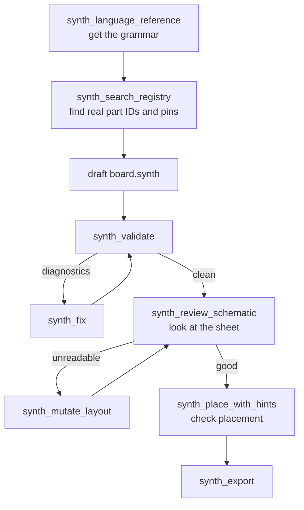

Synth ships a [Model Context Protocol](https://modelcontextprotocol.io) server that exposes the entire compiler as tools an AI assistant can call. An agent can search for parts, draft a design, read structured diagnostics, repair its own mistakes, inspect the rendered schematic, and export a KiCad project — without leaving its tool surface.

This is optional. Everything Synth does works from the [command line](/user-guide/cli) alone. But it is the reason diagnostics are structured JSON carrying byte spans and machine-applicable fixes rather than just prose.

## Transports

| Transport      | Command                       | Use case                                                                             |
| :------------- | :---------------------------- | :----------------------------------------------------------------------------------- |
| **stdio**      | `synth mcp --stdio`           | AI agent harnesses — Claude Desktop, Cursor, Claude Code. **Recommended.**           |
| **HTTP + SSE** | `synth mcp --sse --port 8081` | Custom agents and scripts. Endpoints: `/rpc`, `/message`, `/sse`. Binds `127.0.0.1`. |

## Configuration

### Claude Desktop

**macOS:** `~/Library/Application Support/Claude/claude_desktop_config.json`
**Windows:** `%APPDATA%\Claude\claude_desktop_config.json`

```json
{
  "mcpServers": {
    "synth": {
      "command": "synth",
      "args": ["mcp", "--stdio"]
    }
  }
}
```

### Claude Code

```bash
claude mcp add synth -- synth mcp --stdio
```

### Cursor and other editors

Add an MCP server entry whose command is `synth mcp --stdio`. Consult your editor's MCP documentation for the file location.

### OpenCode

OpenCode reads MCP servers from `opencode.json` in the project root, or from `~/.config/opencode/opencode.json` for every project. Its local-server schema uses `command` as an array and `environment` instead of `env`.

```json title="~/.config/opencode/opencode.json"
{
  "$schema": "https://opencode.ai/config.json",
  "mcp": {
    "synth": {
      "type": "local",
      "command": ["synth", "mcp", "--stdio"],
      "environment": {
        "SYNTH_REGISTRY": "/home/you/code/synth/registry/parts"
      },
      "enabled": true
    }
  }
}
```

For a project-local setup, put the same `mcp` block in `opencode.json` at the repository root. Use an absolute path for `command` when `synth` is not on OpenCode's `PATH`:

```json
"command": ["/home/you/code/synth/target/release/synth", "mcp", "--stdio"]
```

Restart OpenCode after changing the file. The Synth tools appear as the `synth_*` tools in the next session; if they do not, run `synth mcp --stdio` by hand to see the server's error.

<Callout type="info" title="Running from a checkout?">

Replace `"synth"` with the absolute path to the built binary, and set the registry explicitly so it resolves regardless of the working directory the client launches in:

```json
{
  "mcpServers": {
    "synth": {
      "command": "/home/you/code/synth/target/release/synth",
      "args": ["mcp", "--stdio"],
      "env": { "SYNTH_REGISTRY": "/home/you/code/synth/registry/parts" }
    }
  }
}
```

</Callout>

## The Agent Design Loop

The order matters. An agent that skips step 1 invents syntax; one that skips step 2 invents pin names.



1. **`synth_language_reference`** — the grammar plus three worked examples.
2. **`synth_search_registry`** — real `(kind, part_id)` pairs, exact pin names, required decoupling.
3. Draft the design. Put every component in a `group`, give each group `notes`, and give every generic passive a `value`.
4. **`synth_validate`** — returns electrical ERC _and_ the readability rules (`E-SYNTH-SCHEM-*`).
5. **`synth_fix`** in a loop until `is_clean` is true.
6. **`synth_review_schematic`** — compile, check, render, and actually look at the returned image.
7. **`synth_place_with_hints`** with `run_routing=false`, then inspect `placement_quality.visual_review`.
8. **`synth_export`**.

## Rules for Agents

These are not stylistic preferences; violating them produces silently wrong hardware.

<Callout type="error">

**`.synth` sources are the only editable design files.** Generated `.kicad_sch`, `.kicad_sym`, `.kicad_pro`, `.kicad_pcb`, and `bom.csv` are build artifacts. A re-export destroys any hand edit without warning.

**Never invent pin numbers.** A ball-grid package uses designators like `A22` and `AC13`, not `1`–`121`. `E-SYNTH-PIN-001` exists to catch fabricated ones. Fix them from the datasheet.

**The two layout sidecars are not interchangeable.** They share a schema but not a coordinate space: `<design>.schematic.layout.toml` holds _sheet_ millimetres, `<design>.placement.layout.toml` holds _board_ millimetres. Passing one where the other is expected silently misplaces parts.

**A missing part is recoverable; a guessed part is not.** Search the registry, import or author a datasheet-backed part, confirm its pins — never substitute a different package silently.

</Callout>

Readability is reviewed on the **rendered sheet**, not inferred. Call `synth_render_schematic` or `synth_review_schematic` and look at the image to catch what connectivity checks cannot: overlapping labels, confusing crossings, a component outside its group box, content past the page edge.

## Tool Catalogue

Thirty-five tools, grouped by what they are for.

### Start here

| Tool                       | What it does                                                                                                                                                                                                               |
| :------------------------- | :------------------------------------------------------------------------------------------------------------------------------------------------------------------------------------------------------------------------- |
| `synth_language_reference` | The full SynthSpec grammar, component-kind vocabulary, `placement_hint` attributes, units, plus three complete example designs. **Call this before drafting from scratch.**                                                |
| `synth_query_knowledge`    | Query the circuit-design knowledge graph: switch debounce, pull-ups, LED current limiting, IC decoupling, relay flyback, I²C pull-ups, crystal load caps, USB ESD — with rationale and, given a design, which are missing. |

### Finding parts

| Tool                           | What it does                                                                                                                                     |
| :----------------------------- | :----------------------------------------------------------------------------------------------------------------------------------------------- |
| `synth_search_registry`        | Search by keyword, kind, or MPN. Returns part IDs, descriptions, **pin names**, LCSC numbers, and required decoupling.                           |
| `synth_search_registry_vector` | Natural-language search over 384-dimension dense embeddings. For when you know the intent but not the vocabulary.                                |
| `synth_search_registry_web`    | Search LCSC/EasyEDA for candidates with live stock and price. Falls back to the local registry when offline, so an agent always gets candidates. |
| `synth_import_part`            | Import into the Tier-2 registry from LCSC, a KiCad symbol library, or a KiCad-format zip.                                                        |
| `synth_author_part`            | Validate and persist a hand-authored TOML part definition. Stays unverified until `reviewed_by` is set.                                          |
| `synth_resolve_footprints`     | Find a real `.kicad_mod` for parts naming an uninstalled footprint. With `apply=true`, writes the correction.                                    |

### Validation and repair

| Tool                              | What it does                                                                                                                                                                 |
| :-------------------------------- | :--------------------------------------------------------------------------------------------------------------------------------------------------------------------------- |
| `synth_validate`                  | Compile and validate a design file or string. Structured diagnostics with byte spans and patch suggestions.                                                                  |
| `synth_erc_report`                | Electrical rule checks on their own — power, I²C, SPI, decoupling.                                                                                                           |
| `synth_drc_report`                | Physical design rule checks on a placed and routed board. Checks the placement review first and returns `placement_requires_revision` rather than routing an invalid layout. |
| `synth_fix`                       | Apply the highest-confidence fix for each blocking diagnostic in one pass. **Call in a loop until `is_clean`.**                                                              |
| `synth_apply_patch`               | Apply structured patch primitives directly: `replace_range`, `insert_at`, `delete_range`, `solve_smt`.                                                                       |
| `synth_predict_patch_consequence` | Predict which new diagnostics a proposed patch would create, using the learned patch-consequence model.                                                                      |
| `synth_evaluate_thermal_si`       | Sub-millisecond signal-integrity and thermal physics: characteristic impedance, propagation delay, temperature rise.                                                         |

### Schematic review

| Tool                       | What it does                                                                                                                                                               |
| :------------------------- | :------------------------------------------------------------------------------------------------------------------------------------------------------------------------- |
| `synth_review_schematic`   | **One-pass review packet:** compile, ERC, readability rules, render the sheet, summarize the layout, optionally compare to the stored baseline. Start here.                |
| `synth_render_schematic`   | Render the schematic to PNG so you can inspect your own output.                                                                                                            |
| `synth_preview_schematic`  | Auto-layout and visual placement data without rendering.                                                                                                                   |
| `synth_mutate_layout`      | One structured visual edit — move or rotate a component, group components into a column, force a net to render as a label, re-route a net. **Never changes connectivity.** |
| `synth_schematic_baseline` | Store or compare a visual baseline. `set` captures, `compare` reports PASS or DRIFT with the changed bounding box. Use this to catch regressions across revisions.         |

### Placement

| Tool                          | What it does                                                                                                                                                                                                                |
| :---------------------------- | :-------------------------------------------------------------------------------------------------------------------------------------------------------------------------------------------------------------------------- |
| `synth_place_with_hints`      | Run the placer with explicit `region` / `edge` / `near` / `side` hints. Returns positions, hint satisfaction, visual-review findings, cluster and compactness warnings, and unrouted net count. Does not modify the source. |
| `synth_describe_placement`    | Human-readable semantic summary: which functional clusters sit in which board regions, density warnings, DRC status.                                                                                                        |
| `synth_compact_layout`        | Compact a pinned placement until the router stops succeeding. One attempt per call, scaling inward 3% a step, recording pass or fail.                                                                                       |
| `synth_read_layout_overrides` | Read persisted placement overrides and forced net labels from a sidecar.                                                                                                                                                    |
| `synth_write_layout_override` | Write or update a placement override or forced net label in a sidecar.                                                                                                                                                      |

### Routing

| Tool                           | What it does                                                                                                                                                                                     |
| :----------------------------- | :----------------------------------------------------------------------------------------------------------------------------------------------------------------------------------------------- |
| `synth_router_capabilities`    | Which routing engines are installed and usable, the version each would run at, and — when unavailable — the reason and remediation. **Call this first when routing fails.**                      |
| `synth_route`                  | Route with an external engine and report the run record. Synth does not generate copper: it hands an un-routed board to the engine, then re-derives connectivity from the copper that came back. |
| `synth_route_with_constraints` | Route with per-net trace width, clearance, preferred layer, and differential-pair constraints.                                                                                                   |

### Export

| Tool                      | What it does                                                                                                                                                                 |
| :------------------------ | :--------------------------------------------------------------------------------------------------------------------------------------------------------------------------- |
| `synth_export`            | Export to `.kicad_sch`, `.kicad_pcb`, and BOM CSV. Does **not** write Gerbers or drill files — `synth export-kicad --gerbers --drill` does, and it refuses unreviewed parts. |
| `synth_export_multiboard` | Validate a multi-board system, verify inter-board header connections, and check cross-board signal continuity and voltage-domain isolation.                                  |

### Cost and supply chain

| Tool                      | What it does                                                                                                                        |
| :------------------------ | :---------------------------------------------------------------------------------------------------------------------------------- |
| `synth_live_supply_chain` | Real-time stock, MOQ, pricing, and lifecycle for a part number or a whole BOM, across LCSC and Nexar/Mouser/DigiKey.                |
| `synth_cost_report`       | Deterministic manufacturing cost report from frozen supplier offers and dated inputs. Set `input.budget` to get a `budget_outcome`. |
| `synth_cost_budget_plan`  | Rank a bounded set of frozen cost candidates against their target budgets. Unresolved evidence is never treated as a budget pass.   |

### Under development

| Tool                           | Status                                                                    |
| :----------------------------- | :------------------------------------------------------------------------ |
| `synth_cloud_mcp_endpoint`     | Cloud MCP endpoint extension — under active local development.            |
| `synth_multi_agent_synthesize` | World-model multi-agent board synthesis — under active local development. |

## Gate Order Before Any Handoff

An agent that reports a board as ready should have passed these, in order:

1. `synth_validate` — zero blocking diagnostics
2. `synth_place_with_hints` — placement visual review clean
3. `synth_render_schematic` — sheet inspected
4. `synth_export`
5. `kicad-cli sch erc` — zero errors

<Callout type="warn">

Export rejects unresolved compilation diagnostics. Generated artifacts from a failed attempt are not release evidence, and a stage that could not run is reported `unknown` — never as a pass. See [`synth check`](/user-guide/cli#synth-check).

</Callout>

## Troubleshooting

### The assistant cannot find `synth`

MCP clients often launch with a minimal environment that does not include your shell's `PATH`.

```bash
which synth      # macOS / Linux
where synth      # Windows
```

Use an **absolute path** in the client configuration rather than relying on `PATH`.

### Tools work, but no parts are found

The server resolved a different registry than you expect — most likely the embedded seed, because the client's working directory is not your checkout.

```bash
synth registry path
```

Set `SYNTH_REGISTRY` explicitly in the client's `env` block, or run `synth registry install` once to make the shipped registry resolvable from anywhere.

### Debugging the server

Run it by hand to see its output:

```bash
synth mcp --stdio
```

Or use SSE mode, where you can hit the endpoints with `curl`:

```bash
synth mcp --sse --port 8081
```

## See Also

| Topic                                    | Page                                             |
| :--------------------------------------- | :----------------------------------------------- |
| Syntax the agent should emit             | [SynthSpec Reference](/user-guide/dsl-reference) |
| The sidecar files and the ownership rule | [KiCad Export](/user-guide/kicad-export)         |
| Equivalent CLI commands                  | [CLI Reference](/user-guide/cli)                 |
