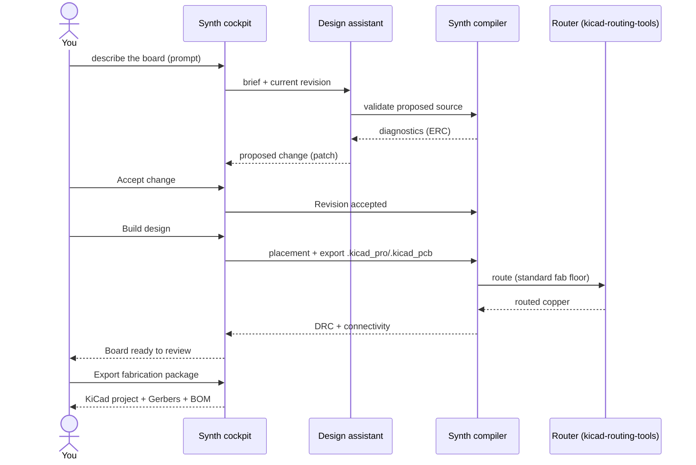

# From Prompt to PCB

Synth takes a plain-language board description all the way to fabrication-ready
KiCad outputs. This page walks the whole path using the
[Class-A reference boards](/user-guide/class-a-boards).



## 1. Prompt


In the cockpit, describe the board in plain language. Either the workspace
assistant, or the brief on the home page, accepts the prompt:

> A 2-layer low-speed sensor breakout. STM32-class MCU is so fine-pitch it needs
> micro-vias — instead use a DIP-28 MCU and a JST-PH power connector, an I2C
> BME680 with 4.7k pull-ups, a 3V3 LDO, reset pull-up, and decoupling on every
> rail.

The assistant reads the current revision and the registry, then proposes a
complete `.synth` source. Every proposal is run through the real compiler first,
so what you review is already parseable and resolves.

## 2. Proposal and review

The assistant returns a **proposed change** with a diff. Review it in the
cockpit (canvas + source), then press **Accept change**. Acceptance writes a new
durable revision and hands it to the synthesis engine. Nothing is fabricated
until you explicitly build.

## 3. Build design

**Build design** runs physical synthesis:

1. **Placement** — the placer assigns every component a position, layer and
   rotation under the part's placement hints and the board outline.
2. **Export** — the compiler writes a KiCad project (`.kicad_pro`,
   `.kicad_sch`, `.kicad_sym`, `.kicad_pcb`) with the declared fabrication floor.
3. **Route** — the external router lays copper to the declared floor (`--krt-fab-overrides`); Synth never generates copper itself.
4. **Independent check** — connectivity is re-derived from the copper and a
   KiCad DRC runs. A board is only “ready to review” when both pass.

The cockpit reports **Board ready to review** with the revision id when the
build completes.

## 4. Validate and release

The same pipeline is available headlessly:

```bash
# 1) logical validation (parse, resolve, ERC)
synth validate board.synth

# 2) route to a declared fabrication floor and check the result
synth route board.synth \
  --router kicad-routing-tools \
  --kicad-routing-tools-repo "$KICAD_ROUTING_TOOLS_REPO" \
  --krt-fab-overrides fab_jlc_standard.txt \
  --krt-escalation board
# exit 0 => state: routed, open_nets: 0, blocking_reasons: []

# 3) release package (compiler + DRC + full KiCad manufacturing export)
synth check board.synth --fab

# or export the project and Gerbers directly
synth export-kicad board.synth --out out/board --gerbers --drill
```

The release package contains `board.kicad_pro`, `board.kicad_sch`,
`board.kicad_sym`, `board.kicad_pcb`, `bom.csv`, `pnp.csv`, and the Gerber/drill
archives.

> [!WARNING]
> An export is marked **not for fabrication** until copper has passed routing.
> Confirm `state: routed` and `open_nets: 0` before releasing Gerbers — a routed
> look in the viewer is not the same as an independently checked board.

## 5. A worked example

The `sensor_logger` reference board, prompt to fabrication:

| Stage | Result |
|---|---|
| Prompt → proposal | assistant returns the `.synth`; `synth validate` = exit 0 |
| Accept → revision | durable revision (`accepted`) |
| Build design | placement + export + route |
| Route (JLC standard) | `state: routed`, `open_nets: 0`, vias ≥ 0.30 mm |
| Independent DRC | 0 errors, 0 unconnected |
| Export | KiCad project + `bom.csv` + Gerbers |


## Fabrication floors

A board's minimum geometry comes from its declared `manufacturer`. The reference
boards declare `jlcpcb` and are routed to the JLC standard floor
(`via_drill 0.30 mm`, `track/clearance 0.127 mm`). Finer parts (LQFP-48,
micro-USB, LGA) can only escape through via-in-pad micro-vias below that floor —
which is why the Class-A boards use coarse-pitch parts.
